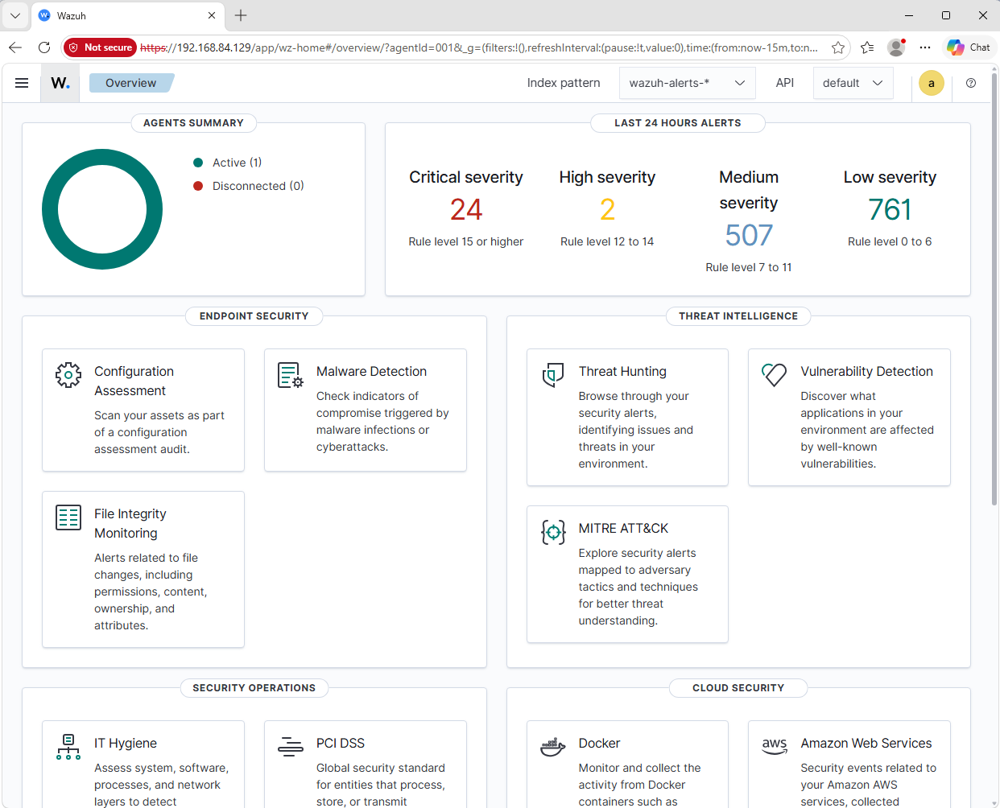
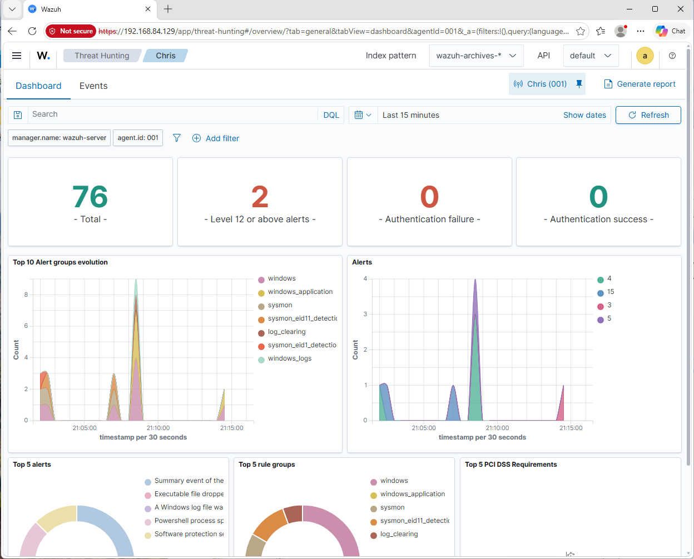
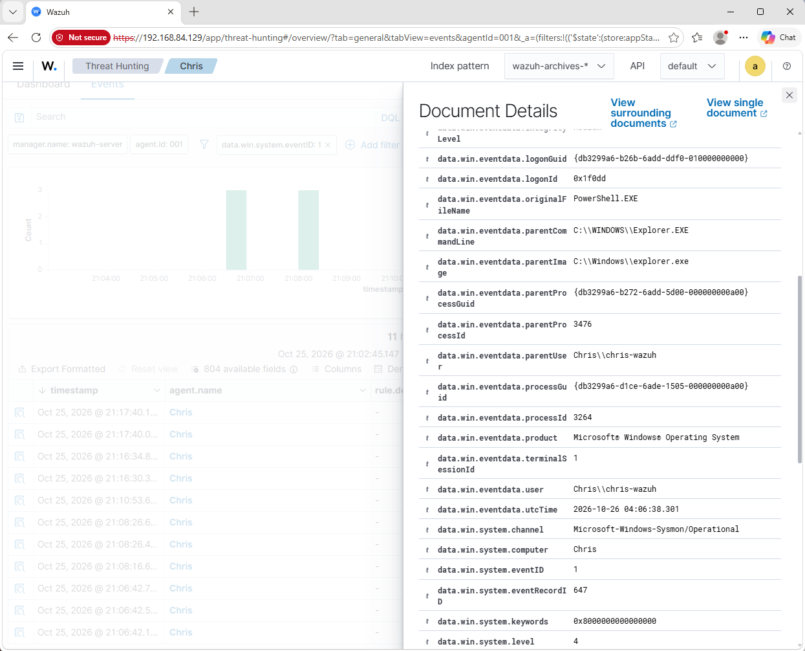
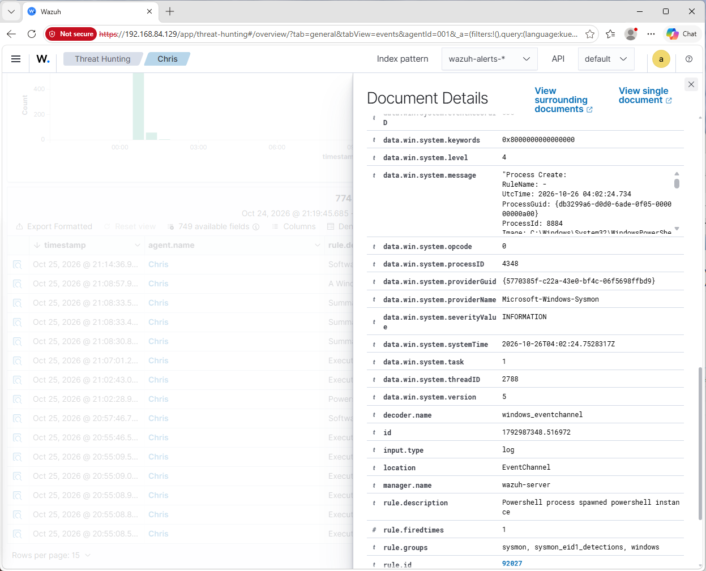
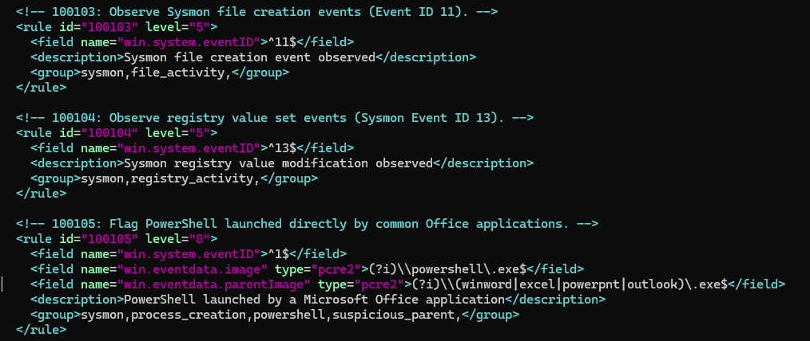

# Windows Endpoint Monitoring with Wazuh

A small home SIEM lab built to practice collecting Windows endpoint telemetry, reviewing security events, and developing detection rules.

## Overview

This lab uses Wazuh to collect and analyze endpoint activity from a Windows machine. Sysmon provides detailed process and system activity, while the Wazuh agent forwards events to a central Ubuntu server for search and alert investigation.

The project focuses on a practical workflow: get endpoint telemetry into the SIEM, locate useful events, inspect their context, and write rules that can highlight activity worth investigating.

## Lab architecture

```text
┌────────────────────────────────┐
│ Windows endpoint               │
│                                │
│ Sysmon                         │
│   └─ Sysmon Operational log    │
│             │                  │
│             ▼                  │
│ Wazuh agent                    │
└─────────────┬──────────────────┘
              │ endpoint events
              ▼
┌────────────────────────────────┐
│ Ubuntu Server                  │
│                                │
│ Wazuh manager                  │
│   └─ Event analysis            │
│                                │
│ Wazuh indexer                  │
│   └─ Searchable event data     │
│                                │
│ Wazuh dashboard                │
│   └─ Search and investigation  │
└────────────────────────────────┘
```

## Environment

| Component | Purpose |
|---|---|
| Ubuntu Server VM | Hosts Wazuh server components |
| Windows VM | Monitored endpoint |
| Wazuh agent | Forwards endpoint telemetry |
| Sysmon | Generates detailed Windows system events |
| VMware | Runs the virtual machines |

## Implementation

### 1. Endpoint telemetry

Installed Sysmon on the Windows endpoint and used the `Microsoft-Windows-Sysmon/Operational` event channel as a source of detailed telemetry. The Wazuh agent forwards collected events to the server.

### 2. Centralized collection and search

Used Wazuh archives and the dashboard's Discover interface to inspect raw events, including Sysmon process-creation events (Event ID 1). The event data can provide fields such as process image, command line, parent process, user, timestamp, and hashes.

### 3. Alert investigation

Reviewed a PowerShell-related alert generated by built-in Wazuh rule `92027` (`Powershell process spawned powershell instance`). The alert maps to MITRE ATT&CK technique `T1059.001` — PowerShell. This is a useful example of how endpoint telemetry can be turned into an alert and investigated in context.

### 4. Custom detection rules

The `custom-rules/` directory contains a local ruleset with five example detections. The rules cover common shell activity, file creation, registry changes, and a potentially suspicious parent-child process relationship. They are intended as a starting point for testing and tuning in the lab.

## Custom rule summary

| Rule ID | Detection idea | Sysmon Event ID | Severity |
|---|---|---:|---:|
| `100101` | PowerShell process creation | 1 | 5 |
| `100102` | Command Prompt (`cmd.exe`) process creation | 1 | 5 |
| `100103` | File creation event | 11 | 5 |
| `100104` | Registry value set event | 13 | 5 |
| `100105` | PowerShell launched by an Office application | 1 | 8 |

These rules identify activity for review. An alert is not, by itself, proof of malicious behavior. Broad rules can be noisy and should be tuned against normal endpoint activity.

## Investigation workflow

For an event or alert, review:

1. **Timestamp and endpoint** — where and when it occurred.
2. **Event type** — which Sysmon event was recorded.
3. **Process context** — image, command line, parent process, and user where available.
4. **Related activity** — nearby events involving the same process, user, or host.
5. **Assessment** — whether the activity is expected, suspicious, or requires more context.

## Screenshots







## Skills demonstrated

- SIEM deployment and endpoint onboarding
- Windows event collection with Sysmon
- Centralized event search and investigation
- Alert triage and event-context analysis
- MITRE ATT&CK mapping
- Basic Wazuh detection-rule authoring
- Linux service administration and troubleshooting

## Possible next improvements

- Tune rules to reduce false positives.
- Build saved searches for selected Sysmon event types.
- Add more detections based on process ancestry, command-line patterns, and persistence-related telemetry.

## Disclaimer

This is a personal learning lab designed for defensive monitoring and detection practice. It is not intended to represent a production-ready SOC deployment.
